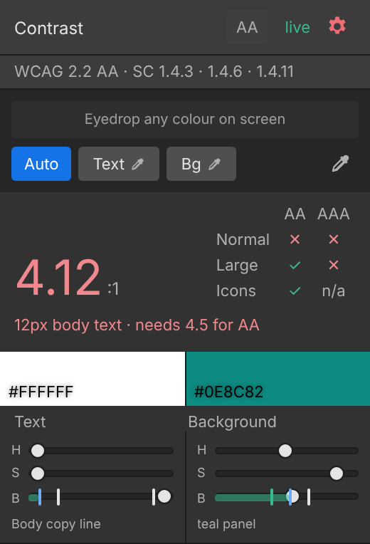

# Umbra Contrast Checker

An Adobe Illustrator panel that measures WCAG colour contrast on live artwork,
explains what it measured, and recolours the artwork for you when it fails.

Free. Illustrator 2020 or newer, on macOS or Windows. [Install in three
steps](#install).

  

It is deliberately unglamorous about one thing. **When it cannot read a colour,
it shows no number at all.** An accessibility tool that guesses is worse than no
tool, because a confident green tick on artwork nobody checked is exactly the
outcome everyone involved was trying to avoid.

Built and maintained by [Artchemy Labs](https://artchemylabs.com).

**Free to use. Source available so you can check it. Not open source.** Use it
for anything, including paid client work, on every machine at your company, at
no cost. Read and modify your own copy. Do not hand it out or sell it. Details
in [LICENSE](LICENSE), which opens with a plain-language summary.

The source is public on purpose. A contrast checker asks you to trust a number,
and you should be able to see how that number was reached.

---

## Requirements

Adobe Illustrator CC 2020 (24.0) or newer, on macOS or Windows.

Nothing else. No account, no subscription, no network connection, no companion
app.

---

## Install

1. **Download** the file for your computer,
   [macOS](../../releases/latest/download/UmbraContrastChecker-macOS.zxp) or
   [Windows](../../releases/latest/download/UmbraContrastChecker-Windows.zxp).
   Every version is on the [Releases](../../releases) page.
2. **Install it** with a free ZXP installer.
   [ZXP Installer](https://aescripts.com/learn/zxp-installer/) from aescripts
   runs on macOS and Windows, and so does [Anastasiy's Extension
   Manager](https://install.anastasiy.com/).
3. **Restart Illustrator** and open **Window, then Extensions, then Umbra
   Contrast Checker**.

To update, install the newer file the same way. It replaces the one you have.

The first time you use the eyedropper, macOS asks for Screen Recording
permission for Illustrator. Grant it once in System Settings, under Privacy and
Security, then click the eyedropper again. That permission is what lets the
panel read the colours your artwork actually renders.

[INSTALL.md](INSTALL.md) has the full walkthrough, a way in without an
installer, and the fixes for the few things that occasionally go wrong.

---

## What it does

**Measures the selection.** Click a text object and the ratio appears, graded
against WCAG 2.2 AA and AAA for body text, large text and non-text contrast. The
background is found for you and composited through opacity and blend modes, so
the number reflects what actually renders rather than what was authored.

**Knows screen from print.** WCAG's large text is 18pt, or 14pt bold, in CSS
points, which on screen is 24px, or 18.66px bold. An Illustrator web document
counts one pixel as one point, so 18px type there is body text and needs 4.5:1,
not 3:1. The panel reads an RGB document as screen and a CMYK one as print, shows
which rule it used in the unit beside the size, and lets you override it under
the gear.

**Explains itself when the answer is surprising.** Black text inside a group at
50% opacity renders as mid-grey, and the panel says so by name rather than just
reporting a low number.

> Text is #000000, but renders #7B7A75 (group "Header" at 50% opacity).
> [Measure the authored colours instead]

**Samples anything on screen.** The preview pane is a loupe. Magnified pixels
around the pointer, with a live hex and a live contrast ratio, so you can hover
across a photo or a gradient and see where text would start passing. Click, or
press Enter, to lock a colour. Your selection is restored afterwards, so the
click leaves nothing behind. Esc gives the colour back to the artwork.

**Suggests fixes and applies them.** Each suggestion shows the ratio it would
achieve and how far it moves from the current colour, ordered from the smallest
visual change to the highest contrast. Clicking one writes it back to every
object sharing that colour, outlined text included. Cmd or Ctrl plus Z undoes
it.

**Adjusts colour with sliders, live.** Hue, saturation and brightness under each
swatch, the way Illustrator's own colour panel works. The compliance thresholds
are drawn on the brightness track at 3:1, 4.5:1 and 7:1, with the passing
stretch painted, so you can see where a colour starts passing before you touch
it. Click a mark to move the least distance that clears it. Dragging previews in
the panel. Letting go writes to the artwork once, as a single undo step.

**Handles text on a gradient.** It grades the worst point along the whole ramp,
not just the stops and never an average, and tells you the range. Grading the
stops misses the middle: #767676 text on a white to black ramp is 4.54:1 against
both ends and 1.00:1 a little past halfway, where the ramp is its own colour. A
red to green ramp is darker in the middle than at either end, so black text that
passes at both stops can fail in between. The panel catches both.

**Offers a fix at every WCAG rung** when the slider cannot get there. One swatch
each for 3:1, 4.5:1 and 7:1, the nearest colour to yours that reaches each. It
appears only when no brightness at your current hue passes, so its presence is
itself information. Rungs no shade of that colour can reach say so rather than
quietly disappearing.

**States what it conforms to.** A line under the header reads *WCAG 2.2 AA · SC
1.4.3 · 1.4.6 · 1.4.11*. Those are the three success criteria the tool
implements, on the face of the panel where a compliance reviewer can see them
without opening a menu. WCAG 2.2 has been the W3C Recommendation since December
2024 and its contrast criteria are unchanged from 2.1 and 2.0, so a requirement
written against any of the three is satisfied by this reading.

**Remembers what you set.** Target level, size override and rendered colour
measurement all survive a restart.

**Works from the keyboard, and passes its own audit.** Every control is in the
tab order. The options popover traps Tab and restores
focus. Verdicts are announced. Pass and fail never rely on colour alone, and
every piece of text and every icon in the panel clears the same thresholds the
panel demands of your artwork.

---

## Known limits

Worth knowing before you rely on it.

- **The loupe lives in the panel, not at the cursor.** A floating magnifier that
  follows the pointer needs a transparent, always on top window, which Adobe's
  extension runtime cannot create.
- **A pick click reaches Illustrator.** Your selection is restored afterwards
  and nothing is left behind, but with a *drawing* tool active the click will
  draw, and that cannot be undone for you. Use the Selection tool, or press
  Enter instead of clicking.
- **A text cursor cannot be restored.** If you had a caret blinking in a text
  frame rather than objects selected, the panel leaves it alone rather than
  guessing where it was.
- **Deeply nested blend groups are approximated.** The panel names the container
  it used, so you can always see what it assumed.
- **Screen samples are display colour.** On a wide gamut monitor the eyedropper
  reads the display's colour space rather than the document's sRGB, and the
  panel says so. Plain solid fills never need the eyedropper: those are read
  straight from the document.
- **CMYK documents** are converted to sRGB for measurement, which is an
  approximation. The panel says so in the gear menu.
- **Outlined text is paths, not text.** The panel cannot tell a headline from
  an icon set, so when a selection is shaped like outlined type it asks, and one
  tap grades it as body or large text, because WCAG grades images of text as
  text unless they are a logo. That answer holds for the one selection and is
  never saved. The panel still recolours every letter when you apply a fix.

---

## Reporting a bug

Open an issue with the panel version, which is at the bottom of the gear menu,
and what the artwork was: a gradient behind text and a flat fill behind text are
different code paths. If Illustrator crashed, attach the newest Adobe Illustrator
`.ips` file from `~/Library/Logs/DiagnosticReports`. It names the exact place it
failed.

**A wrong number is the bug worth reporting fastest.** Everything else in this
panel is a convenience. A confident ratio for artwork it never measured is the
one failure that makes the tool worse than not having it, and it gets fixed
ahead of anything else.

---

## Licence

Umbra Contrast Checker Source-Available License 1.0.
Copyright (c) 2026 Artchemy Labs LLC. All rights reserved.

**You may** use it free for anything, including commercial and paid client work,
on any number of machines. Read the source, audit it, and modify your own copy.
Fork it to study it or to send a change back.

**You may not** distribute it, sell it, bundle it into something you charge for,
publish a build or a renamed version, or list it on any marketplace. Send people
the link to this repository instead. That is always welcome.

Want to do something this does not cover? [Ask](https://artchemylabs.com).
Redistribution and bundling rights are available by agreement.

If it saves you an afternoon, [Ko-fi](https://ko-fi.com/artchemylabs) is there.
